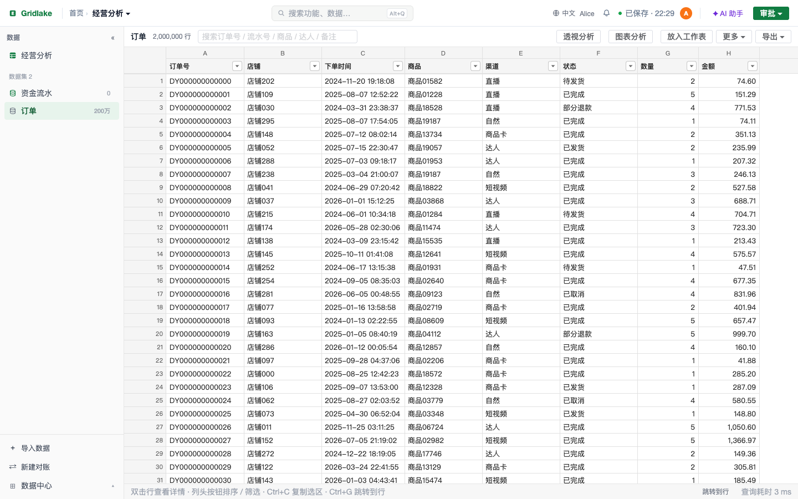
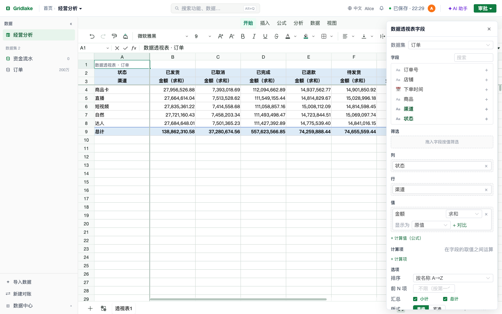

# Gridlake

**开源、可私有部署的亿级数据表格**：像 Excel 一样用公式和透视表分析上亿行数据。表格界面基于 [Univer](https://github.com/dream-num/univer)，数据放在服务端的 [DuckDB](https://github.com/duckdb/duckdb) 里，浏览器只取看到的那一屏。

> An open-source, self-hosted spreadsheet for 100M-row datasets — Excel-style formulas and pivot tables on top of DuckDB. The UI is available in Chinese and English (switch in the top bar; most screens are translated, some runtime messages are still Chinese). **English overview: [README.en.md](README.en.md)**





<sub>截图：200 万行合成订单数据（由 `scripts/seed-demo.py` 生成），本机发布版服务；重新生成用 `web/tests/ui/readme-shots.mjs`。</sub>

## 为什么

- Excel 最多 104 万行，数据一多就打不开；
- BI 工具做固定看板很好，但没有 Excel 那样随手写公式、拖透视、自由排版的灵活；
- 数据库式表格（Airtable / NocoDB / Teable 一类）是「每列一个类型、一行一条记录」，不是 Excel 式的自由表格。

Gridlake 的做法是：**界面是 Excel 式的表格，大数据集在服务端 DuckDB 里计算**。普通工作表、公式、图表照常在浏览器里；引用大数据集的透视表、公式、数据表、图表都下推到服务端算。

## 性能（实测）

在 1 亿行 × 8 列的合成订单数据上（MacBook 8 核 16 GB，发布版服务，通过 HTTP 接口测得；浏览器里看到的耗时会稍长）：

| 操作 | 耗时 |
|---|---|
| 打开整张表（不建任何中间表） | 52 毫秒 |
| 按店铺筛选（命中 33 万行） | 约 0.1 秒 |
| 透视：店铺 × 月份 | 1.8 秒 |
| SQL 分组汇总 | 0.5 秒 |
| 公式 `DSUMIFS` 单个（两个条件） | 0.17 秒 |
| 导出 33 万行 CSV | 1.8 秒 |

偏慢的操作也如实列出：冷启动全表排序 11.6 ~ 18 秒（之后同条件 3 毫秒）、1 亿唯一值的精确去重计数 17 ~ 44 秒（可改用近似去重）。复现方法见 `server/tests/bench/README.md`。

## 功能

- **大数据集**：导入 CSV / Excel / Parquet / JSON，连接 ClickHouse、MySQL / PostgreSQL、HTTP 接口；筛选、排序、搜索、计算列、关联视图、回收站
- **透视表**：服务端计算，写成普通工作表；计算值（毛利率等）、计算项、首个 / 末个、占比 / 同比 / 环比、近似分位数；每个格子可下钻到明细并自动核对；可「转为数据表」再按值筛选
- **公式下推**：`=SUMIFS(订单表[金额], 订单表[店铺], B2)` 这类写法在服务端算；`DSUMIFS` / `DCOUNTIFS` 等平台函数；导出 xlsx 时转回 Excel 原生公式
- **数据表嵌入工作表**：浮动表格或直接写成单元格，随数据集与切片器刷新
- **SQL 工作台**：只读 SQL、参数化查询（按类型安全代入）、另存为数据集、定时重算
- **仪表盘**：切片器（值 / 日期，跨数据集联动）、指标卡、图表联动、演示模式
- **AI 助手**（接你自己的 OpenAI 兼容模型）：给出方案卡，确认后才写入、可撤销；异常发现；外部 AI 通过 MCP 只读查询
- **多人填报**：收集任务——几十家店铺 / 部门往同一个数据集里各填各的，每个人只能看到、填自己负责的单位（自动同步成数据权限），按期次开启，看板上看谁填了、谁没填
- **阈值告警**：指标（或两个汇总值的比率，如退款率）按分组超过阈值时通知到企业微信 / 钉钉 / 飞书 / 邮件；可比较较上期的变化（销售额下降 30%）、监控数据停更（哪家店铺几天没有新订单了）；样本量保护，同一个问题只在新出现时通知，恢复时可通知，保存前可「试算」
- **只读分享链接**：给没有账号的客户 / 合作方发一个链接，只读查看一个工作簿（含图表、指标卡、切片器的实时数据），不能编辑、导出，数据范围不超过创建人，可设有效期、随时吊销
- **协作与治理**：实时协作、评论与 @ 提醒；登录（内置账号 / 网关 / 反向代理）、操作审计、按店铺的行级权限、文件审批与月结审批、应用内通知
- **其他**：xlsx 导入导出（条件格式、表格、行列分组、命名区域）、模板（可参数化）、定时推送到企业微信 / 钉钉 / 飞书 / 邮件、版本历史

项目最早的使用场景是电商财务，这部分做成了可选的**场景包**（`LEDGER_PACKS=ecommerce`）：导入抖店资金流水、店铺档案、月结锁账与审批、余额勾稽、提现 / 银行对账、经营分析，以及相关的内置模板。**默认只在库里已有台账数据时才启用**，新装的实例看到的是纯粹的通用表格平台（数据集、透视表、公式、SQL、仪表盘、协作），不会有这些入口。内置的通用模板（应收应付对账、银行余额调节表、库存进销存、月度经营分析）不受影响。

## 快速开始

### 一分钟体验（Docker）

```bash
git clone <本仓库地址> && cd gridlake
mkdir -p data && sudo chown -R 10001:10001 data
docker compose -f deploy/docker-compose.yml up -d
docker logs gridlake 2>&1 | grep 初始密码      # 首次启动随机生成的管理员密码
```

浏览器打开 `http://localhost:8787/excel`，用 `admin` 和上面的密码登录。想先看看效果，导入一份示例数据（合成的订单，默认 100 万行，用 Docker 部署时在本机执行）：

```bash
# 先登录取令牌（把 <密码> 换成上面日志里的初始密码），再导入
TOKEN=$(curl -s -X POST http://localhost:8787/api/ledger/auth/login -H 'Content-Type: application/json' \
        -d '{"username":"admin","password":"<密码>"}' | python3 -c 'import sys,json; print(json.load(sys.stdin)["data"]["token"])')
scripts/seed-demo.py --url http://localhost:8787 --token "$TOKEN" --rows 2000000
```

> 经常要用脚本调接口的话，在页面右上角用户菜单 →「访问令牌」创建一个个人访问令牌（`glp_…`，可设有效期、随时吊销），比登录令牌（几天过期）更适合，见[部署手册](deploy/部署手册.md)。

然后在页面里：新建工作簿 → 左侧「数据」面板点开「订单」→ 工具栏「透视分析」。同事的账号在首页「自动化 → 账号管理」里创建。

> 镜像默认从 GitHub Container Registry 拉取发布版（`deploy/docker-compose.yml`）。想用本地源码构建：
> `docker build -f deploy/Dockerfile -t gridlake:local . && GRIDLAKE_IMAGE=gridlake:local docker compose -f deploy/docker-compose.yml up -d`。
> 发布到 GitHub 后用 `scripts/set-repo.sh 用户名/仓库名` 把文档里的占位符 `OWNER` 换成真实地址。

### 从源码运行（开发）

需要 Rust 1.85+、Node 20+ 与 pnpm、C++ 编译器（后端内置 DuckDB，首次编译约 5 ~ 15 分钟）。

```bash
# 后端（默认 http://127.0.0.1:8787，不开启登录；加 LEDGER_AUTH_MODE=local 使用内置账号）
cd server && cargo run

# 前端（另开一个终端，http://localhost:5173/excel/home）
cd web && pnpm install && pnpm dev
```

macOS 上如果编译 DuckDB 报 `'memory' file not found`，加上：`export CXXFLAGS="-isystem $(xcrun --show-sdk-path)/usr/include/c++/v1"`。

### 私有化部署

安装包、systemd、备份恢复、HTTPS、登录方式与权限见 [deploy/部署手册.md](deploy/部署手册.md)。

## 登录方式

| `LEDGER_AUTH_MODE` | 说明 |
|---|---|
| `off`（默认） | 不登录，任何能访问页面的人都可以使用全部功能。**只适合本机试用**：监听非本机地址（或 `LEDGER_CORS=*`）时服务会拒绝启动，确认已有其他保护才可用 `LEDGER_ALLOW_NO_AUTH=1` 放行 |
| `local`（推荐） | 内置账号：管理员在页面里建账号；密码 PBKDF2-SHA256 保存，失败次数限制（重启不清零），登录记入审计；会话令牌放在 HttpOnly cookie 里，页面脚本读不到；可再配 `LEDGER_OIDC_*` 加上**单点登录**（Keycloak / Okta / Azure AD 等，首次登录自动建账号） |
| `gateway` | 对接已有的统一登录：浏览器带的令牌由服务端转给网关校验 |
| `proxy` | 由反向代理（nginx `auth_request`、OAuth2 Proxy 等）传入身份，可接 OIDC / LDAP |

## 目录

| 目录 | 内容 |
|---|---|
| `server/` | 后端：Rust + axum + DuckDB（数据集、透视、公式下推、SQL、AI、协作、权限、审批） |
| `web/` | 前端：Vue 3 + Univer + Element Plus |
| `deploy/` | Dockerfile、docker-compose、安装脚本、部署手册 |
| `scripts/` | 敏感内容检查、示例数据导入（`seed-demo.py`）、版本 / 许可证检查 |
| `docs/` | [架构](docs/architecture.md)、[公式与 Excel 兼容](docs/formulas.md)、[REST 接口](docs/api.md)（路线图见 [ROADMAP.md](ROADMAP.md)） |

## 测试

```bash
cd server && cargo test                       # 后端单元测试
cd server && tests/e2e/run.sh                 # 后端端到端测试（每个文件起一个临时库的服务）
cd web && pnpm test:unit                   # 前端单元测试
cd web && pnpm test:ui                     # 界面测试（需要本机 Chrome）
scripts/check-forbidden.sh                           # 敏感内容检查：私钥、内网地址、非官方 npm 源
scripts/check-version.sh                             # 后端与前端版本号一致
python3 -I scripts/gen-third-party.py --check        # 依赖的许可证都在允许清单里
git config core.hooksPath .githooks                  # 提交前自动做上面的检查
```

## 现状与局限

- 单机 DuckDB，没有分布式；「十亿行」没有测过
- 界面有中文和英文（右上角切换），英文覆盖了绝大部分界面和服务端报错；电商台账场景、部分运行时提示、代码注释和部署文档仍是中文
- AI 助手的效果取决于接入的模型，还没有系统评测
- 还没有在 Linux 生产环境长期运行过；欢迎反馈问题

## 参与

欢迎提 Issue 和 PR：先读 [CONTRIBUTING.md](CONTRIBUTING.md)；后续计划见 [ROADMAP.md](ROADMAP.md)，版本变化见 [CHANGELOG.md](CHANGELOG.md)。发现安全问题请按 [SECURITY.md](SECURITY.md) 私下报告，不要公开提 Issue。参与即同意遵守[行为准则](CODE_OF_CONDUCT.md)。

## 商标与关联声明

Gridlake 是独立的开源项目，与 Microsoft（Excel）、字节跳动 / 抖音（抖店、巨量千川）、Univer 团队、DuckDB 基金会以及文中提到的其他产品和公司**没有隶属、合作或背书关系**。这些名称只用来说明兼容性或数据来源（例如「导入抖店资金流水」「导出 xlsx 在 Excel 里打开」），商标归各自所有者。

## 许可证

[Apache-2.0](LICENSE)。依赖的 Univer（Apache-2.0）、DuckDB（MIT）等各自的许可证见 [THIRD_PARTY_LICENSES.md](THIRD_PARTY_LICENSES.md)，归属声明见 [NOTICE](NOTICE)。
